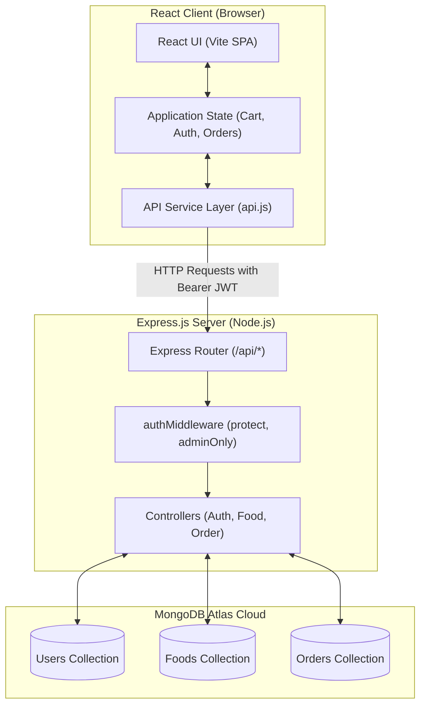

# Food Ordering System (Foodie) 🍕🚀

A modern, responsive, and secure Full-Stack Food Ordering & Delivery Web Application built using the **MERN** stack (MongoDB Atlas, Express.js, React.js, Node.js) with Vite.

Designed for college academic evaluation and production-grade demonstration, **Foodie** delivers a seamless food ordering experience for customers and a comprehensive management dashboard for restaurant administrators.

---

## Table of Contents

- [1. Project Title and Description](#1-project-title-and-description)
- [2. Project Objectives](#2-project-objectives)
- [3. Features for Customers](#3-features-for-customers)
- [4. Features for Admin](#4-features-for-admin)
- [5. Technology Stack](#5-technology-stack)
- [6. Project Folder Structure](#6-project-folder-structure)
- [7. System Architecture](#7-system-architecture)
- [8. Database Collections & Schemas](#8-database-collections--schemas)
- [9. REST API Endpoints](#9-rest-api-endpoints)
- [10. Installation and Setup Instructions](#10-installation-and-setup-instructions)
- [11. Environment Variables (.env.example)](#11-environment-variables-envexample)
- [12. How to Run Frontend and Backend](#12-how-to-run-frontend-and-backend)
- [13. Security Features](#13-security-features)
- [14. Future Scope](#14-future-scope)
- [15. Conclusion](#15-conclusion)

---

## 1. Project Title and Description

**Foodie** is an end-to-end food ordering platform that bridges the gap between hungry food lovers and kitchen staff. 

- **Frontend**: A high-performance, single-page application (SPA) created with **React 19** and **Vite**, styled with modern CSS (custom responsive design, glassmorphism accents, and accessible layouts).
- **Backend**: A robust RESTful API built on **Node.js** and **Express.js**, adhering to MVC architectural patterns.
- **Database**: Cloud-hosted **MongoDB Atlas** with **Mongoose ODM** for schema enforcement and data modeling.
- **Authentication**: Stateless, role-based JSON Web Token (**JWT**) authentication with **bcryptjs** password hashing.

---

## 2. Project Objectives

1. **User Experience**: Provide an intuitive, fast, and visually appealing food discovery and ordering experience.
2. **Data Integrity & Security**: Protect sensitive user data through strong hashing, tokenized authorization, and strict server-side price validation.
3. **Role-Based Access Control (RBAC)**: Clearly separate customer privileges from administrative controls.
4. **Reliability & Scalability**: Establish an decoupled client-server architecture capable of handling asynchronous orders and inventory updates.
5. **Academic Rigor**: Serve as a reference model for modern web engineering standards, API design, and clean directory structure for academic assessment.

---

## 3. Features for Customers

- **Dynamic Food Menu**: Explore authentic dishes categorized by Pizza, Burger, Biryani, Chinese, Desserts, and Drinks.
- **Instant Search & Filtering**: Real-time text search by dish title/description, category pills, and vegetarian/non-vegetarian filter toggle.
- **Persistent Shopping Cart**: Add, increase, decrease, or remove dishes; cart items persist in browser `localStorage`.
- **Promo Code Discounts**: Interactive coupon system (`FOODIE50`, `FREEDEL`, `BIRYANIWEEK`) with instant discount deduction.
- **Secure Authentication**: Modal-based user registration and login with form validation and feedback notifications.
- **Tamper-Proof Checkout**: Place Cash-on-Delivery (COD) orders with custom delivery addresses. Prices are calculated exclusively by the backend database.
- **Live Order Tracking**: Visual 4-stage order stepper (`Confirmed` 📝 → `Cooking` 🍳 → `On Way` 🛵 → `Delivered` 🏠) in the **My Orders** portal.

---

## 4. Features for Admin

- **Restricted Access**: Admin dashboard is only accessible to accounts with `role: "admin"`. Customers are blocked via UI routing, component barriers, and API middleware.
- **Overview & Business Metrics**:
  - **Total Orders**: Live count of all orders placed across the platform.
  - **Gross Revenue**: Cumulative earnings in INR (`₹`) calculated across all active orders.
  - **Menu Item Counter**: Total active dishes with in-stock and out-of-stock breakdowns.
  - **Total Registered Users**: Count of registered customer and staff accounts.
  - **Fulfillment Pipeline**: Real-time counter cards for Confirmed, Cooking, On Way, Delivered, and Cancelled orders.
- **Order Management**:
  - View comprehensive customer orders including delivery addresses, phone numbers, line items, and totals.
  - Live status updater dropdown (`Confirmed`, `Preparing`, `On Way`, `Delivered`, `Cancelled`).
  - Search orders by Order ID, customer name, contact phone, or destination city.
  - Detailed modal view displaying itemized billing and fulfillment metadata.
- **Food Catalog Management (CRUD)**:
  - **Create**: Add new dishes with image preview, prep time, veg/non-veg flag, price, and category.
  - **Read**: Browse all items with search and category filters.
  - **Update**: Edit dish titles, descriptions, prices, categories, and prep times.
  - **Availability Toggle**: One-click toggle between `In Stock` and `Out of Stock`.
  - **Delete**: Remove dishes permanently with safety confirmation alerts.
- **User Directory**: View registered customer names, emails, contact numbers, and registration timestamps.

---

## 5. Technology Stack

| Layer | Technology | Purpose |
| :--- | :--- | :--- |
| **Frontend Library** | React.js (v19) | Reactive user interface & component hierarchy |
| **Frontend Tooling** | Vite (v8) | Blazing-fast development server & production bundler |
| **Styling** | Custom CSS3 | Responsive grid/flexbox, typography, and animations |
| **Backend Runtime** | Node.js (v20+) | Asynchronous event-driven server runtime |
| **Backend Framework**| Express.js (v5) | HTTP REST API routing and middleware pipeline |
| **Database** | MongoDB Atlas | Multi-region cloud NoSQL document database |
| **ODM** | Mongoose (v9) | Schema validation, hooks, and model abstraction |
| **Authentication** | JSON Web Tokens (`jsonwebtoken`) | Stateless token authorization |
| **Cryptography** | `bcryptjs` | Salted one-way password hashing (10 salt rounds) |
| **Cross-Origin** | `cors` | Cross-Origin Resource Sharing control |
| **Configuration** | `dotenv` | Environment variable management |

---

## 6. Project Folder Structure

```text
Food-Ordering-System/
├── .gitignore                      # Global git exclusion rules
├── README.md                       # Comprehensive project documentation
│
├── backend/                        # Backend REST API Server
│   ├── config/
│   │   └── db.js                   # Mongoose connection with IPv4 & retry logic
│   ├── controllers/
│   │   ├── authController.js       # Register, Login, Me, and Admin user listing
│   │   ├── foodController.js       # Food catalog CRUD controllers
│   │   └── orderController.js      # Order creation, calculation, and status updates
│   ├── middleware/
│   │   └── authMiddleware.js       # JWT 'protect' & 'adminOnly' guards
│   ├── models/
│   │   ├── Food.js                 # Food schema with validation & enums
│   │   ├── Order.js                # Order subdocument schema & statuses
│   │   └── User.js                 # User schema with bcrypt pre-save hook
│   ├── routes/
│   │   ├── authRoutes.js           # Auth endpoint router
│   │   ├── foodRoutes.js           # Food endpoint router
│   │   └── orderRoutes.js          # Order endpoint router
│   ├── utils/
│   │   ├── generateToken.js        # JWT signing utility
│   │   ├── seedFoods.js            # Initial food catalog database seeder
│   │   └── seedAdmin.js            # Secure environment-driven admin seeder
│   ├── .env.example                # Safe backend environment template
│   ├── package.json                # Backend dependencies and run scripts
│   └── server.js                   # Express server bootstrap & listener
│
└── frontend/                       # React Frontend Application
    ├── public/                     # Static public assets
    ├── src/
    │   ├── assets/                 # SVGs and branding images
    │   ├── components/
    │   │   ├── AdminDashboard.jsx  # Admin control center & analytics UI
    │   │   ├── AdminDashboard.css  # Admin panel styles
    │   │   ├── AuthModal.jsx       # Login & Sign-up modal dialog
    │   │   ├── CartDrawer.jsx      # Slide-out shopping cart & address input
    │   │   ├── CategoryFilter.jsx  # Category selection bar
    │   │   ├── CheckoutSuccessModal.jsx # Order confirmation popup
    │   │   ├── FoodCard.jsx        # Single dish card with qty counter
    │   │   ├── FoodList.jsx        # Food catalog grid with veg & sort filters
    │   │   ├── Footer.jsx          # Application footer & navigation links
    │   │   ├── Hero.jsx            # Hero banner with live search input
    │   │   ├── Navbar.jsx          # Sticky header with role-aware controls
    │   │   ├── OrdersModal.jsx     # Customer order history & live stepper
    │   │   ├── SpecialOffers.jsx   # Promo code banner cards
    │   │   └── WhyChooseUs.jsx     # Feature highlights section
    │   ├── data/
    │   │   └── foodData.js         # Offline fallback menu items
    │   ├── services/
    │   │   └── api.js              # Fetch client with auto JWT injection
    │   ├── App.jsx                 # Main application state & routing controller
    │   ├── App.css                 # Global layout & toast notification styles
    │   ├── index.css               # Typography and CSS reset
    │   └── main.jsx                # React DOM root mounting entry
    ├── .env.example                # Safe frontend environment template
    ├── package.json                # Frontend dependencies and Vite scripts
    └── vite.config.js              # Vite build and plugin configuration
```

---

## 7. System Architecture



---

## 8. Database Collections & Schemas

### 1. `users` Collection ([`User.js`](file:///c:/Users/dkdbg/OneDrive/Desktop/Food-Ordering-System/backend/models/User.js))
| Field | Type | Rules | Description |
| :--- | :--- | :--- | :--- |
| `name` | String | Required, Trim, 2-50 chars | User's full name |
| `email` | String | Required, Unique, Lowercase, Regex | Account email address |
| `password` | String | Required, Min 6 chars, `select: false` | Bcrypt password hash |
| `role` | String | Enum: `["customer", "admin"]`, Default: `"customer"` | Access level |
| `phone` | String | Trim, Optional | Contact phone number |
| `timestamps` | Date | Automatic | `createdAt` and `updatedAt` |

### 2. `foods` Collection ([`Food.js`](file:///c:/Users/dkdbg/OneDrive/Desktop/Food-Ordering-System/backend/models/Food.js))
| Field | Type | Rules | Description |
| :--- | :--- | :--- | :--- |
| `name` | String | Required, Trim, Max 100 chars | Name of the dish |
| `description` | String | Required, Trim, Max 500 chars | Ingredients and preparation |
| `price` | Number | Required, Min: 0 | Price in INR (₹) |
| `image` | String | Required, Valid URL | Hosted image link |
| `category` | String | Enum: `Pizza`, `Burger`, `Biryani`, `Chinese`, `Desserts`, `Drinks` | Food category |
| `isAvailable` | Boolean | Default: `true` | Stock availability |
| `isVeg` | Boolean | Default: `true` | Vegetarian flag |
| `rating` | Number | Range: 1.0 to 5.0, Default: 4.5 | Customer review rating |
| `prepTime` | String | Default: `"20-25 min"` | Estimated kitchen time |

### 3. `orders` Collection ([`Order.js`](file:///c:/Users/dkdbg/OneDrive/Desktop/Food-Ordering-System/backend/models/Order.js))
| Field | Type | Rules | Description |
| :--- | :--- | :--- | :--- |
| `user` | ObjectId | Ref: `User`, Required | Customer who placed the order |
| `items` | Array | Min 1 subdocument | Item snapshot (`food`, `name`, `price`, `quantity`) |
| `totalAmount`| Number | Required, Calculated by server | Grand total in INR (₹) |
| `deliveryAddress`| Object | Required (`street`, `city`, `pincode`, `phone`) | Delivery destination |
| `status` | String | Enum: `Confirmed`, `Preparing`, `On Way`, `Delivered`, `Cancelled` | Fulfillment state |
| `paymentMethod`| String | Enum: `COD`, `Card`, `UPI`, `NetBanking`, Default: `COD` | Payment type |
| `paymentStatus`| String | Enum: `Pending`, `Completed`, `Failed`, Default: `Pending` | Payment state |

---

## 9. REST API Endpoints

### 🔐 Authentication Routes (`/api/auth`)
| Method | Endpoint | Access | Description |
| :--- | :--- | :--- | :--- |
| `POST` | `/api/auth/register` | Public | Register customer account (strictly forces `role: customer`) |
| `POST` | `/api/auth/login` | Public | Authenticate user & issue signed JWT Bearer token |
| `GET` | `/api/auth/me` | Customer / Admin | Retrieve current authenticated user profile |
| `GET` | `/api/auth/users` | Admin Only | Get all registered platform accounts |

### 🍕 Food Catalog Routes (`/api/food`)
| Method | Endpoint | Access | Description |
| :--- | :--- | :--- | :--- |
| `GET` | `/api/food` | Public | Get all food items (supports `?category=`, `?search=`, `?all=`) |
| `GET` | `/api/food/:id` | Public | Get single dish details by MongoDB ObjectId |
| `POST` | `/api/food` | Admin Only | Add a new dish to the catalog |
| `PUT` | `/api/food/:id` | Admin Only | Update existing dish price, details, or availability |
| `DELETE` | `/api/food/:id` | Admin Only | Permanently delete dish from menu |

### 📦 Order Management Routes (`/api/orders`)
| Method | Endpoint | Access | Description |
| :--- | :--- | :--- | :--- |
| `POST` | `/api/orders` | Customer | Place order (prices calculated server-side from database) |
| `GET` | `/api/orders/myorders`| Customer | Get order history for the logged-in customer |
| `GET` | `/api/orders/:id` | Owner / Admin | Get specific order details (IDOR protected) |
| `GET` | `/api/orders` | Admin Only | Get all orders across the entire platform |
| `PUT` | `/api/orders/:id/status`| Admin Only | Update fulfillment status (*Confirmed → Preparing → On Way → Delivered*) |

### 📡 System Routes
| Method | Endpoint | Access | Description |
| :--- | :--- | :--- | :--- |
| `GET` | `/api/health` | Public | System status and API health verification |

---

## 10. Installation and Setup Instructions

### Prerequisites
- [Node.js](https://nodejs.org/) (Version 18 or higher recommended)
- [MongoDB Atlas](https://www.mongodb.com/atlas) account (or a local MongoDB instance)
- Git (optional, for version tracking)
- Windows PowerShell, Command Prompt, or bash

### Step 1: Clone or Navigate to Project
```powershell
cd c:\Users\dkdbg\OneDrive\Desktop\Food-Ordering-System
```

### Step 2: Install Backend Dependencies
```powershell
cd backend
npm install
cd ..
```

### Step 3: Install Frontend Dependencies
```powershell
cd frontend
npm install
cd ..
```

---

## 11. Environment Variables (.env.example)

### Backend Configuration (`backend/.env`)
Create a file named `backend/.env` based on `backend/.env.example`:

```env
# Server Port & Mode
PORT=5000
NODE_ENV=development

# MongoDB Atlas Connection String
# Replace with your actual credentials:
MONGO_URI=mongodb+srv://<username>:<password>@<cluster-url>/FoodOrderingSystem?retryWrites=true&w=majority

# JWT Authentication Secret (Use a strong, random 32+ character string)
JWT_SECRET=your_jwt_super_secret_development_key_2026

# Optional: Seed Administrator Credentials (used only by npm run seed:admin)
# ADMIN_NAME="System Administrator"
# ADMIN_EMAIL="admin@foodie.com"
# ADMIN_PASSWORD="your_secure_password"
```

### Frontend Configuration (`frontend/.env`)
Create a file named `frontend/.env` based on `frontend/.env.example`:

```env
# URL where the Express Backend API is listening
VITE_API_BASE_URL=http://localhost:5000/api
```

> [!IMPORTANT]
> Never commit actual `.env` files containing credentials to GitHub or any public repository. Both files are excluded by `.gitignore`.

---

## 12. How to Run Frontend and Backend

To run both services simultaneously, open two separate Windows PowerShell windows:

### Terminal 1 — Start the Backend Server:
```powershell
cd backend
npm run dev
```
- The backend server boots on: **`http://localhost:5000`**
- Verifies and connects to MongoDB Atlas
- Displays: `🚀 Foodie API Server running on port 5000`

*(Optional) Seed the catalog with 12 authentic dishes:*
```powershell
npm run seed:foods
```

*(Optional) Seed an Admin account:*
```powershell
$env:ADMIN_NAME="System Administrator"
$env:ADMIN_EMAIL="admin@foodie.com"
$env:ADMIN_PASSWORD="YourStrongAdminPassword"
npm run seed:admin
$env:ADMIN_PASSWORD=""
```

### Terminal 2 — Start the Frontend Development Server:
```powershell
cd frontend
npm run dev
```
- The frontend Vite development server launches at: **`http://localhost:5173`**
- Features Hot Module Replacement (HMR) for instant code updates.

Open your browser and navigate to:
👉 **`http://localhost:5173`**

---

## 13. Security Features

1. **Bcrypt Password Hashing**: Passwords are never stored as plain text. The Mongoose `User` model employs a `pre("save")` hook to hash passwords using `bcryptjs` with salt round 10.
2. **Stateless JWT Tokens**: Authenticated requests require a JSON Web Token signed with `JWT_SECRET`. Tokens are transmitted via the `Authorization: Bearer <token>` header.
3. **Password Hash Redaction**: Schema-level `select: false` prevents password hashes from leaking in query results, logs, or JSON responses.
4. **Server-Side Price Authority**: The client cart submits only food IDs and quantities. The backend fetches authoritative prices directly from MongoDB Atlas to calculate `totalAmount`, defeating client-side price tampering.
5. **Privilege Boundary Enforcement**: Public self-registration (`/api/auth/register`) hardcodes `role: "customer"`. Users cannot elevate their own role to `"admin"`.
6. **Insecure Direct Object Reference (IDOR) Mitigation**: Order lookup (`GET /api/orders/:id`) checks ownership before returning order records. Customers cannot inspect orders belonging to other users.
7. **Input Validation**: Mongoose schemas enforce types, regex validation on emails, minimum string lengths, and value enums.

---

## 14. Future Scope

- **Online Payment Gateway**: Integration with Stripe, Razorpay, or PayPal for digital payments, credit cards, and UPI webhooks.
- **Real-Time WebSockets**: Using `Socket.io` for live rider GPS tracking and real-time kitchen status push notifications without manual polling.
- **Email & SMS Notifications**: Integration with SendGrid or Twilio to dispatch automated invoice receipts and delivery OTPs.
- **AI Recommendation Engine**: Machine learning-based personalized dish recommendations based on past order history.
- **Cross-Platform Mobile App**: React Native mobile application for Android and iOS devices.

---

## 15. Conclusion

The **Food Ordering System (Foodie)** provides a solid demonstration of modern, decoupled full-stack software development. By leveraging the strengths of **React 19**, **Vite**, **Express.js**, and **MongoDB Atlas**, the platform provides high responsive performance, clean component boundaries, and dependable security.

This project fulfills all criteria for academic submission, Pair Programming showcases, and serves as an extensible foundation for a full commercial food delivery venture.

---

*Academic Project — Food Ordering System (Foodie)*  
*Built with ❤️ using the MERN Stack.*
