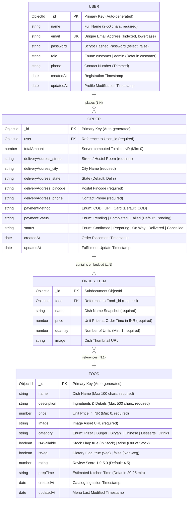

# Entity Relationship (ER) Diagram — Food Ordering System (Foodie) 🍕📊

This document provides a comprehensive **Entity Relationship (ER) Diagram** and database architecture specification for the **Food Ordering System (Foodie)**, derived directly from the application's production **Mongoose (MongoDB)** models located in `backend/models/`.

---

## 1. Visual Entity Relationship Diagram (Mermaid)

---

## 2. Cardinality and Relationships Breakdown

| Relationship | Type | Cardinality | Explanation |
| :--- | :--- | :--- | :--- |
| **`User` → `Order`** | One-to-Many | `1 : 0..*` | A single registered customer (`User`) can place zero, one, or many `Orders` over time. Every `Order` must link to exactly one customer via `order.user`. |
| **`Order` → `OrderItem`** | One-to-Many (Embedded) | `1 : 1..*` | Each `Order` document embeds an array of one or more `OrderItem` subdocuments. An order cannot exist without at least one item. |
| **`OrderItem` → `Food`** | Many-to-One (Referenced) | `0..* : 1` | Each `OrderItem` stores the `ObjectId` reference of its corresponding `Food` catalog document, alongside a snapshot of dish attributes. |

---

## 3. Entity Data Dictionary

### 3.1. `User` Entity ([`backend/models/User.js`](file:///c:/Users/dkdbg/OneDrive/Desktop/Food-Ordering-System/backend/models/User.js))
Represents customer accounts and platform administrators.

| Attribute Name | Data Type | Constraint / Rule | Description |
| :--- | :--- | :--- | :--- |
| **`_id`** | `ObjectId` | **PK**, Auto-generated | MongoDB BSON 12-byte unique identifier |
| **`name`** | `String` | Required, Trimmed, Length: 2–50 chars | Full legal / display name |
| **`email`** | `String` | Required, Unique, Lowercase, Regex | Login email address (e.g. `user@example.com`) |
| **`password`** | `String` | Required, Min 6 chars, `select: false` | 60-character bcrypt salted hash (`$2a$10$...`) |
| **`role`** | `String` | Enum: `["customer", "admin"]`, Default: `"customer"` | Access tier for Role-Based Access Control (RBAC) |
| **`phone`** | `String` | Trimmed, Optional (Default: `""`) | Primary contact number |
| **`createdAt`** | `Date` | Timestamp (Automatic) | Account registration ISO date |
| **`updatedAt`** | `Date` | Timestamp (Automatic) | Last profile update ISO date |

---

### 3.2. `Food` Entity ([`backend/models/Food.js`](file:///c:/Users/dkdbg/OneDrive/Desktop/Food-Ordering-System/backend/models/Food.js))
Represents culinary dishes available for customer order.

| Attribute Name | Data Type | Constraint / Rule | Description |
| :--- | :--- | :--- | :--- |
| **`_id`** | `ObjectId` | **PK**, Auto-generated | MongoDB BSON unique identifier |
| **`name`** | `String` | Required, Trimmed, Max 100 chars | Dish title (e.g. *"Hyderabadi Dum Biryani"*) |
| **`description`** | `String` | Required, Trimmed, Max 500 chars | Culinary description and ingredients |
| **`price`** | `Number` | Required, Min: 0 | Current selling price in INR (₹) |
| **`image`** | `String` | Required, Trimmed | Secure HTTPS image URL |
| **`category`** | `String` | Enum: `Pizza`, `Burger`, `Biryani`, `Chinese`, `Desserts`, `Drinks` | Menu categorization |
| **`isAvailable`** | `Boolean` | Default: `true` | Kitchen stock toggle (In Stock vs. Out of Stock) |
| **`isVeg`** | `Boolean` | Default: `true` | Dietary classification (Vegetarian vs. Non-Veg) |
| **`rating`** | `Number` | Range: `1.0` to `5.0`, Default: `4.5` | Customer rating score |
| **`prepTime`** | `String` | Trimmed, Default: `"20-25 min"` | Expected preparation and dispatch time |
| **`createdAt`** | `Date` | Timestamp (Automatic) | Catalog creation date |
| **`updatedAt`** | `Date` | Timestamp (Automatic) | Catalog modification date |

---

### 3.3. `Order` Entity ([`backend/models/Order.js`](file:///c:/Users/dkdbg/OneDrive/Desktop/Food-Ordering-System/backend/models/Order.js))
Represents customer purchase transactions and delivery fulfillment states.

| Attribute Name | Data Type | Constraint / Rule | Description |
| :--- | :--- | :--- | :--- |
| **`_id`** | `ObjectId` | **PK**, Auto-generated | Unique order transaction ID |
| **`user`** | `ObjectId` | **FK** (`ref: "User"`), Required | Identifier of customer who placed the order |
| **`items`** | `[OrderItem]` | Array of Subdocuments, Min: 1 item | List of ordered items (see section 3.4) |
| **`totalAmount`** | `Number` | Required, Min: 0, Server-calculated | Authoritative billing total in INR (₹) |
| **`deliveryAddress`**| `Object` | Required Sub-schema | Destination coordinates: |
| ↳ `street` | `String` | Required, Trimmed | Hostel name, room number, or street line |
| ↳ `city` | `String` | Required, Trimmed | Delivery city |
| ↳ `state` | `String` | Default: `"Delhi"`, Trimmed | Delivery state |
| ↳ `pincode` | `String` | Required, Trimmed | 6-digit postal code |
| ↳ `phone` | `String` | Required, Trimmed | Contact phone number for delivery driver |
| **`paymentMethod`**| `String` | Enum: `["COD", "UPI", "Card"]`, Default: `"COD"` | Payment mode |
| **`paymentStatus`**| `String` | Enum: `["Pending", "Completed", "Failed"]` | Financial settlement state |
| **`status`** | `String` | Enum: `["Confirmed", "Preparing", "On Way", "Delivered", "Cancelled"]` | Current delivery lifecycle stage |
| **`createdAt`** | `Date` | Timestamp (Automatic) | Order placement ISO timestamp |
| **`updatedAt`** | `Date` | Timestamp (Automatic) | Last fulfillment status change |

---

### 3.4. `OrderItem` Embedded Entity ([`backend/models/Order.js`](file:///c:/Users/dkdbg/OneDrive/Desktop/Food-Ordering-System/backend/models/Order.js#L3-L28))
Subdocument embedded within `Order.items` capturing the item snapshot at the moment of checkout.

| Attribute Name | Data Type | Constraint / Rule | Description |
| :--- | :--- | :--- | :--- |
| **`_id`** | `ObjectId` | **PK** (Subdocument) | Unique subdocument identifier |
| **`food`** | `ObjectId` | **FK** (`ref: "Food"`), Required | Reference pointer to original food document |
| **`name`** | `String` | Required, Trimmed | Historical snapshot of dish name |
| **`price`** | `Number` | Required, Min: 0 | Historical snapshot of unit price in INR (₹) |
| **`quantity`** | `Number` | Required, Min: 1 | Quantity ordered |
| **`image`** | `String` | Trimmed, Optional | Snapshot of dish image URL |

---

## 4. NoSQL Schema Design Strategy: Referencing vs. Embedding

A key architectural strength of this system is the deliberate hybrid use of **Referencing (Normalized)** and **Embedding (De-normalized)** patterns:

### 4.1. Why `OrderItem` is Embedded inside `Order`
- **Historical Price Immutability**: If a restaurant administrator changes the price of *"Margherita Pizza"* from ₹349 to ₹399 next week, historical past orders must **not** change their total. Embedding the price and name snapshot inside the order guarantees historical financial accuracy.
- **Atomic Single-Read Operations**: When customers inspect their order history via `GET /api/orders/myorders`, MongoDB retrieves the complete order including all dish items in a single read query without expensive multi-collection `$lookup` joins.
- **Bounded Document Growth**: Since food orders rarely contain more than 10–20 line items, document size remains well below MongoDB's 16MB BSON limit.

### 4.2. Why `User` and `Food` are Referenced via `ObjectId`
- **Dynamic Catalog Updates**: Dishes are updated, enabled, or disabled regularly by administrators. Referencing keeps the `foods` collection as the single source of truth for the active storefront catalog.
- **Account Separation**: User credentials, passwords, and profile details evolve independently from transactional orders.

---

## 5. College Viva / Exam Q&A Reference

### Q1: Why did you choose MongoDB over a Relational SQL database (like MySQL)?
> **Answer**: MongoDB's document model allows natural mapping of domain objects (e.g. embedding an array of ordered items and complex delivery addresses directly inside an order document). It also offers horizontal scalability and native JSON handling that integrates seamlessly with our Express/Node and React technology stack.

### Q2: How does the system handle database normalization?
> **Answer**: We use a **hybrid pattern**:
> - **Normalized (Referenced)**: `User` and `Food` entities are maintained in independent collections with primary keys (`_id`) to avoid data duplication across catalog updates and user profiles.
> - **De-normalized (Embedded)**: `OrderItem` and `deliveryAddress` are embedded directly inside `Order` to create an immutable financial snapshot at the moment the transaction occurs.

### Q3: How do you prevent price tampering if a customer modifies the client-side price in the browser?
> **Answer**: The client only sends `food` ObjectIDs and `quantity` to `POST /api/orders`. The backend controller directly queries MongoDB using `Food.findById()` to retrieve the authoritative database price and computes `totalAmount` on the server before saving. Client-submitted prices are ignored.

### Q4: How is password security maintained in the database?
> **Answer**: We use the `bcryptjs` cryptographic library. A Mongoose `pre("save")` hook automatically intercepts user creation or password modification, generates a salt (10 rounds), and stores only the salted one-way hash. In addition, `select: false` on the schema ensures password hashes are never returned in queries or API responses.

---

*Documentation generated for Food Ordering System (Foodie) — Academic College Project Submission.*
