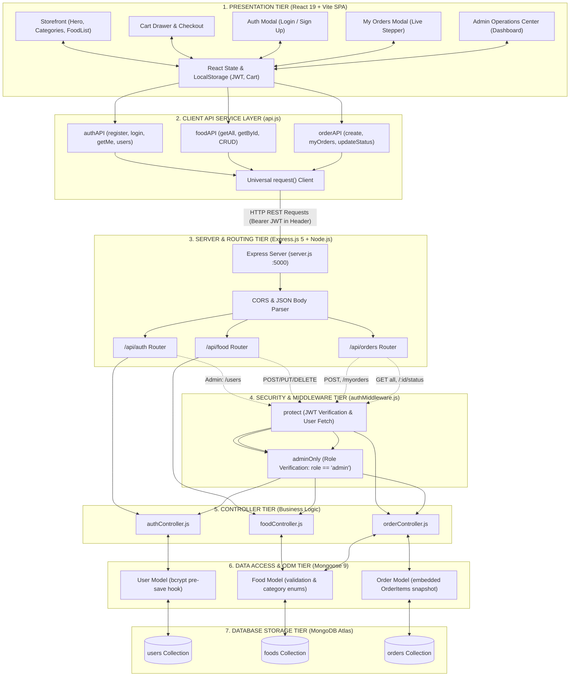
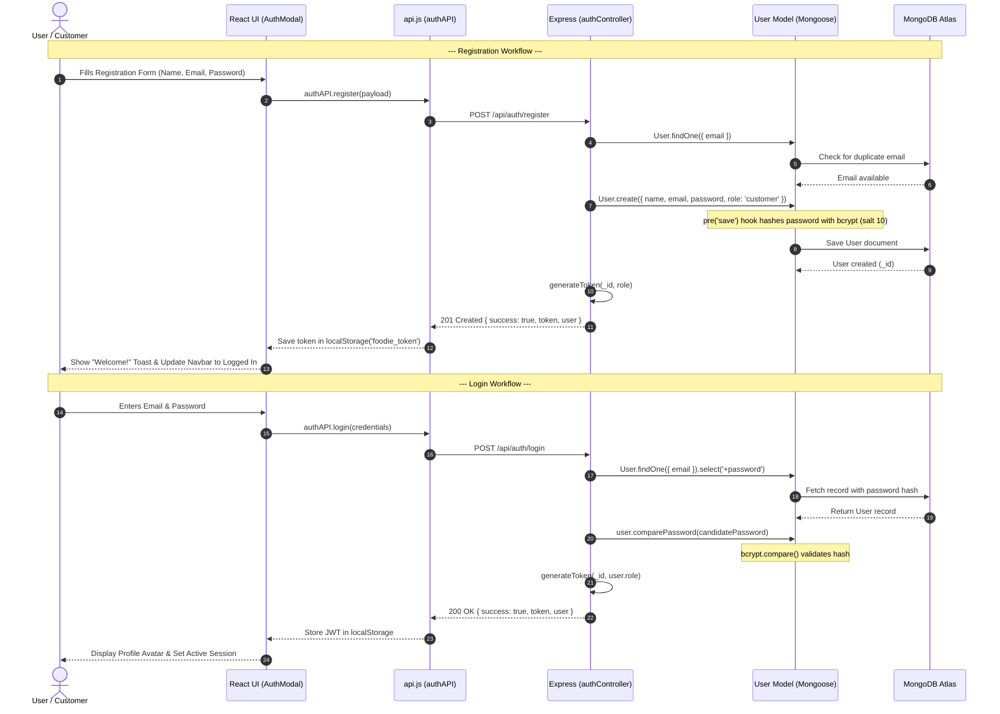
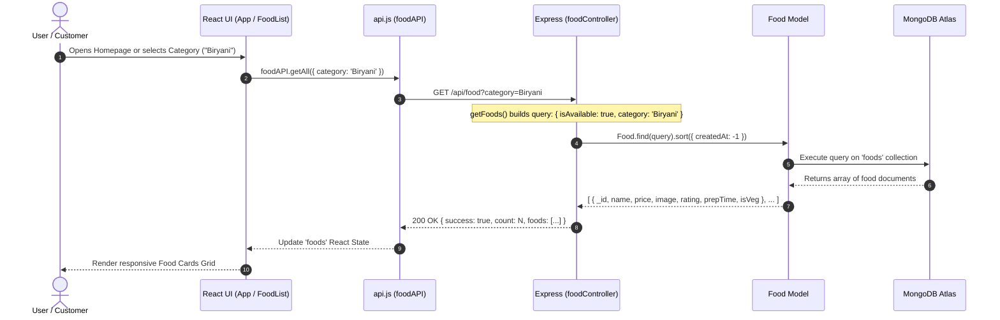
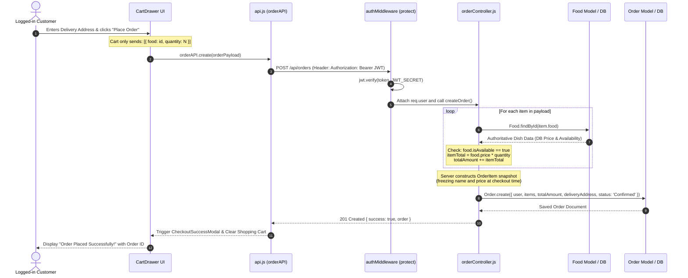
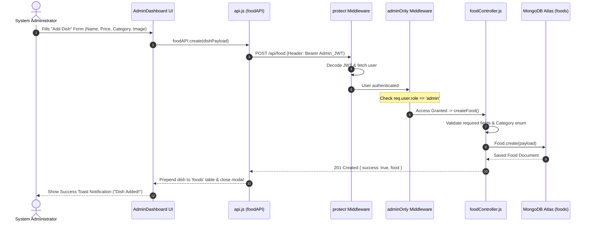
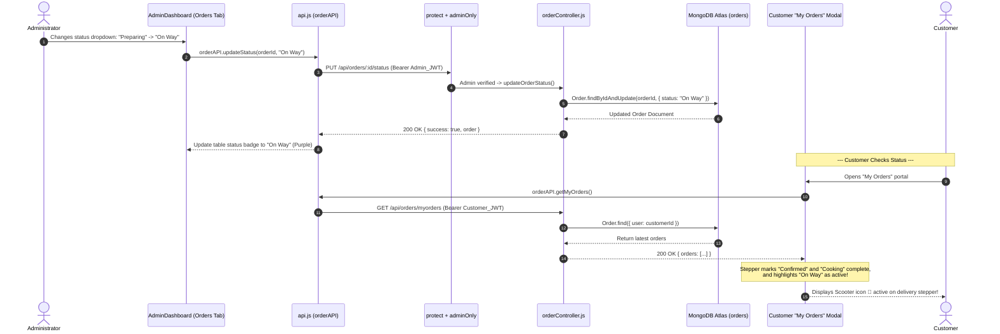

# System Architecture Document — Food Ordering System (Foodie) 🍕🏛️

This document describes the complete **System Architecture** of the **Food Ordering System (Foodie)**, derived directly from the application's actual codebase. It provides multi-tier structural flowcharts, sequence diagrams for key operational workflows, and detailed component explanations suitable for college project evaluation, technical reports, and viva presentations.

---

## 1. High-Level Multi-Tier Architecture Diagram

---

## 2. Core Operational Workflow Diagrams

### 2.1. User Registration and Login Flow (JWT Issuance)

---

### 2.2. Fetching Food Items Catalog Flow

---

### 2.3. Adding and Placing an Order Flow (Server-Side Price Authority)

---

### 2.4. Admin Managing Food Items (CRUD Workflow)

---

### 2.5. Admin Updating Order Status & Live Customer Tracking

---

## 3. Detailed Component Breakdown

### 3.1. Presentation Tier (React 19 + Vite)
- **Role**: Renders the dynamic User Interface, manages client state, and delivers responsive experiences across mobile, tablet, and desktop viewports.
- **Key Modules**:
  - **`App.jsx`**: Top-level coordinator managing global application state (`cartItems`, `user`, `foods`, `orders`, `activeNav`).
  - **`Navbar.jsx`**: Navigation bar with real-time cart badge counter, customer avatar, and role-guarded `🛡️ Admin Panel` link.
  - **`Hero.jsx` & `CategoryFilter.jsx`**: Interactive discovery tools supporting real-time catalog search and category pill filtering.
  - **`FoodList.jsx` / `FoodCard.jsx`**: Grid rendering dishes with veg/non-veg tags, prep times, pricing, and quantity counters.
  - **`CartDrawer.jsx`**: Off-canvas shopping cart supporting promo coupon discounts and delivery address capture.
  - **`OrdersModal.jsx`**: Customer order tracking portal featuring a 4-step delivery pipeline.
  - **`AdminDashboard.jsx`**: Administrative suite featuring real-time business metrics, order fulfillment management, food catalog CRUD, and registered user tables.

---

### 3.2. Client API Service Layer (`frontend/src/services/api.js`)
- **Role**: Centralized communication bridge between the React frontend and Express backend.
- **Key Features**:
  - **Universal `request()` Wrapper**: Automatically retrieves the JWT token from `localStorage.getItem("foodie_token")` and attaches it as `Authorization: Bearer <token>`.
  - **Automatic Error Normalization**: Extracts structured error messages returned by Express and throws standard JavaScript `Error` objects for toast notifications.
  - **Environment-Driven Endpoint Resolution**: Reads `import.meta.env.VITE_API_BASE_URL` with automatic fallback to `http://localhost:5000/api`.

---

### 3.3. Server & Routing Tier (Express.js 5 + Node.js)
- **Role**: Coordinates incoming HTTP requests, terminates cross-origin traffic, handles payload parsing, and routes traffic to specialized controllers.
- **Key Modules**:
  - **`server.js`**: Application entry point. Configures CORS, parses JSON/URL-encoded bodies, and mounts route handlers.
  - **`config/db.js`**: Robust Mongoose initialization module featuring an IPv4-enforced DNS lookup (`family: 4`) and an automatic discovery retry loop tailored for MongoDB Atlas M0 clusters.
  - **Routes**:
    - `routes/authRoutes.js`: Maps endpoints for `/register`, `/login`, `/me`, and `/users`.
    - `routes/foodRoutes.js`: Maps endpoints for public catalog browsing and admin food mutations.
    - `routes/orderRoutes.js`: Maps endpoints for customer checkout, personal order history, and admin fulfillment updates.

---

### 3.4. Security & Middleware Tier (`backend/middleware/authMiddleware.js`)
- **Role**: Enforces stateless authentication and Role-Based Access Control (RBAC).
- **Key Guards**:
  - **`protect` Middleware**:
    1. Extracts Bearer token from the incoming `Authorization` header.
    2. Verifies cryptographic signature using `process.env.JWT_SECRET`.
    3. Queries `User.findById(decoded.id).select("-password")` to ensure the account still exists.
    4. Binds the sanitized user object to `req.user` and passes control to the next handler.
  - **`adminOnly` Middleware**:
    1. Inspects `req.user.role`.
    2. If `req.user.role === "admin"`, invokes `next()`.
    3. If not, halts execution and responds with HTTP `403 Forbidden` (`"Forbidden: Admin privileges required."`).

---

### 3.5. Controller Tier (Business Logic)
- **Role**: Implements domain business rules, coordinates model operations, and formats responses.
- **Key Controllers**:
  - **`authController.js`**: Validates registration formats, prevents duplicate accounts, issues signed JWTs, and enforces default `customer` roles.
  - **`foodController.js`**: Manages food inventory queries (supporting filters for categories, text search, vegetarian flags, and admin stock visibility), validating price bounds and category enums.
  - **`orderController.js`**: Coordinates order placement, calculates prices using the database as the sole source of truth, manages ownership checks to prevent Insecure Direct Object References (IDOR), and handles fulfillment status transitions.

---

### 3.6. Data Access & ODM Tier (Mongoose 9)
- **Role**: Defines strict schemas, applies validation constraints, handles cryptographic hooks, and provides model abstraction.
- **Key Models**:
  - **`User.js`**: Enforces unique lowercase emails, includes a `pre("save")` hook for automatic `bcryptjs` hashing, and provides `comparePassword()` instance methods.
  - **`Food.js`**: Enforces supported categories via schema enums, non-negative price constraints, and stock booleans.
  - **`Order.js`**: Implements a hybrid NoSQL schema embedding an array of `OrderItem` snapshots alongside top-level status enums and delivery coordinates.

---

### 3.7. Database Storage Tier (MongoDB Atlas)
- **Role**: Cloud-managed document storage offering high availability, automated replicas, and persistent BSON storage across three core collections:
  - **`users`**: Stores credentials, profile data, and access roles.
  - **`foods`**: Stores the live restaurant dish catalog.
  - **`orders`**: Stores finalized transactions, frozen item prices, delivery addresses, and fulfillment states.

---

## 4. End-to-End Request-Response Lifecycle

Here is what happens when a customer places an order:

1. **Client Action**: Customer reviews cart items, fills in the hostel/street address, and clicks **Place Order** in [`CartDrawer.jsx`](file:///c:/Users/dkdbg/OneDrive/Desktop/Food-Ordering-System/frontend/src/components/CartDrawer.jsx).
2. **Client Preparation**: `App.jsx` constructs an order payload containing only `{ food: <ObjectId>, quantity: <Number> }` and the address. Client prices are deliberately omitted.
3. **Transport**: `api.js` intercepts the request, reads `foodie_token` from `localStorage`, appends `Authorization: Bearer <token>`, and issues a `POST` request to `http://localhost:5000/api/orders`.
4. **Network & Routing**: Express receives the request, parses the JSON payload, and routes it to `orderRoutes.js`.
5. **Authentication Verification**: `protect` middleware extracts the token, verifies the signature against `JWT_SECRET`, loads the user document from MongoDB, and attaches it to `req.user`.
6. **Price Verification & Integrity Check**:
   - `orderController.js` loops over the item IDs.
   - Queries `Food.findById(id)` from MongoDB Atlas.
   - Verifies that every requested dish is currently `isAvailable === true`.
   - Computes `item.price * item.quantity` using the **database price**.
7. **Document Persistence**: An `Order` document is created with status `Confirmed` and saved to the `orders` collection in Atlas.
8. **HTTP Response**: Express returns `201 Created` with the finalized order JSON.
9. **UI Reaction**: The frontend clears the shopping cart, clears `localStorage("foodie_cart")`, closes the cart drawer, and launches the `CheckoutSuccessModal.jsx`.

---

## 5. Architectural Quality Attributes

| Quality Attribute | Implementation in Foodie |
| :--- | :--- |
| **Security** | Salting & hashing via `bcryptjs`, stateless JWT authentication, schema-level password redaction (`select: false`), and backend price calculation. |
| **Separation of Concerns** | Decoupled client (React SPA) and server (Express REST API) communicating solely via JSON over HTTP. |
| **Reliability** | IPv4 enforcement (`family: 4`) with multi-attempt primary discovery loop in `config/db.js` resolving Atlas TLS alert 80 handshakes on Windows. |
| **Maintainability** | Standard Model-View-Controller (MVC) organization with clear boundaries across routes, controllers, and Mongoose schemas. |
| **Scalability** | Stateless server architecture allowing horizontal Node.js clustering behind load balancers with central MongoDB Atlas clustering. |

---

*Documentation generated for Food Ordering System (Foodie) — College Project & Viva Examination Submission.*
